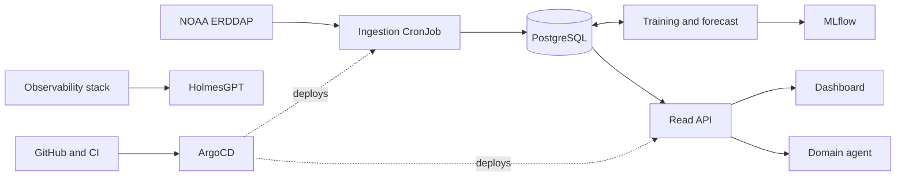

# Atalaya

Atalaya is an early-warning platform for coral reef thermal stress in Costa Rica. It ingests daily NOAA Coral Reef Watch satellite data, forecasts thermal stress with explainable machine learning, and presents the result in plain language.

It is a learning and portfolio project. It does not replace official NOAA alerts.

**Status:** Phase F0 (repository and documentation). Nothing runs yet.

## Planned architecture

Details and stack in [`docs/03-architecture.md`](docs/03-architecture.md). In short: a daily ingestion job fills PostgreSQL, a forecast model (XGBoost with SHAP) writes predictions, a read API serves them to a dashboard and to agents, and everything runs on Kubernetes deployed from Git.

## Documentation

The Markdown files in this repository are the single source of truth.

- [`AGENTS.md`](AGENTS.md): rules for AI agents and the mentor modes
- [`docs/00-spec.md`](docs/00-spec.md): specification (start here)
- [`docs/01-prd.md`](docs/01-prd.md): product requirements
- [`docs/02-trd.md`](docs/02-trd.md): technical requirements
- [`docs/03-architecture.md`](docs/03-architecture.md): architecture
- [`docs/04-api-guide.md`](docs/04-api-guide.md): API conventions
- [`docs/05-security-guide.md`](docs/05-security-guide.md): security
- [`docs/06-code-style-guide.md`](docs/06-code-style-guide.md): code style
- [`docs/07-design-guide.md`](docs/07-design-guide.md): dashboard design
- [`docs/08-testing-guide.md`](docs/08-testing-guide.md): testing
- [`docs/09-implementation-plan.md`](docs/09-implementation-plan.md): plan and gates
- [`docs/10-tasks.md`](docs/10-tasks.md): tasks
- [`docs/11-memory.md`](docs/11-memory.md): project memory and decisions
- [`docs/decisions/`](docs/decisions/): architecture decision records (ADRs)

## How to run

TODO. This section is written in F2, when `make up` exists.

## License

MIT. See [`LICENSE`](LICENSE).
