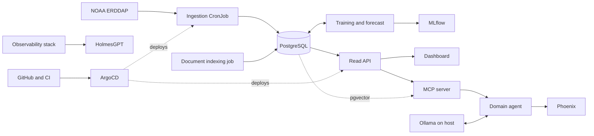

# Architecture

Everything here is Proposed unless marked Decided. Decided items come from `00-spec.md` and the ADRs in `docs/decisions/`.

## 1. Overview

Data enters through a daily ingestion job, is stored in PostgreSQL, and feeds the forecast, the read API and the agents. Everything runs in a Kubernetes cluster (local first, cloud later) and is deployed from Git.



The core is ingestion, database, API and dashboard. Everything else is added by branch and platform layer.

This Mermaid chart is the quick text overview. The detailed, explorable diagram is [`docs/diagrams/architecture.html`](diagrams/architecture.html), generated with Archify from `docs/diagrams/architecture.json` (ADR-014). It follows section 4 (arrows from caller to callee) and links every component to its lines in this document and the ADRs. GitHub shows it as source, so open it locally.

## 2. Technology stack

| Layer | Technology | Status | Why |
| --- | --- | --- | --- |
| Data source | NOAA Coral Reef Watch 5 km (`dhw_5km`) via ERDDAP, PacIOOS mirror by default | Decided | Public, daily, global; NOAA's own servers often time out (ADR-021) |
| Language (data and ML) | Python 3.14 with uv | Decided | Ecosystem for data and ML; newest version the ML stack supports (ADR-016) |
| Database | PostgreSQL 18 (`pgvector/pgvector` image, pinned by digest) | Proposed |
| Migrations | Plain SQL applied with dbmate | Decided | SQL written by hand, schema snapshot in Git, small runner for Kubernetes (ADR-017) | Relational, solid for time series at this volume |
| API | FastAPI | Proposed | Typed, generates OpenAPI |
| Dashboard | Next.js (TypeScript) | Proposed | Owner already uses it; keeps focus on data and infrastructure |
| Model | XGBoost with SHAP | Decided | Replicates the reference study and is explainable |
| ML tracking | MLflow from the first trained model (F5) | Decided | Comparable history of runs; adding it later means rebuilding experiments |
| Containers | Docker | Proposed | Standard and already known |
| Local cluster | kind or k3d | Proposed | Free and repeatable |
| GitOps | ArgoCD | Proposed | Git as the source of truth for the cluster |
| Observability | Prometheus, Grafana, Loki, OpenTelemetry | Proposed | Open source, covers metrics, logs and traces |
| Log collector | Grafana Alloy | Proposed | Ships logs to Loki; Promtail reached end of life on 2026-03-02 |
| Operations agent | HolmesGPT | Decided | CNCF project that reads Prometheus, Loki and the Kubernetes API |
| Language model runtime | Ollama on the host with a small open-weight model | Proposed | Free, uses the laptop GPU, OpenAI-compatible API (ADR-006) |
| Agent tools | MCP server (Python SDK) | Proposed | Standard way to give agents tools; read-only by design (ADR-007) |
| Document search | pgvector plus PostgreSQL full text, fused with RRF | Proposed | No extra service; full text catches exact terms such as DHW (ADR-007, ADR-019) |
| LLM observability | Arize Phoenix | Proposed | Single container, built on OpenTelemetry (ADR-008) |
| IaC | Terraform (local cluster from F3, AWS in F8) | Decided | Industry standard; practiced for free before the cloud (ADR-013) |
| Ingress | Gateway API, implementation chosen in F3 | Decided | Successor of the Ingress API; the Ingress NGINX controller is retired (ADR-018) |
| Cluster secrets | Sealed Secrets | Decided | Free, fits GitOps: encrypted secrets can live in Git (ADR-011) |
| Image registry | GHCR | Proposed | Free with the repository; images built and pushed from CI |
| CI security | gitleaks, CodeQL, Trivy | Decided | Secret, code and image scanning with pinned actions (ADR-012) |
| Cloud | AWS (free plan, F8 only) | Decided | Most demanded in the job postings reviewed (ADR-010) |
| CI | GitHub Actions | Proposed | Already used |

## 3. Components and responsibilities

| Component | Does | Does not do |
| --- | --- | --- |
| Ingestion job | Downloads NOAA data for defined sites, validates it, writes it idempotently, logs each run | Train models or serve users |
| PostgreSQL | Stores sites, observations, forecasts, run logs and document chunks with embeddings (pgvector) | Hold business logic beyond constraints and views |
| Training and forecast job | Builds features, trains, evaluates temporally, writes forecasts and SHAP values | Download NOAA data |
| MLflow | Records runs, parameters, metrics and artifacts | Serve predictions |
| Read API | Exposes sites, history and forecasts in a documented format | Write data (except the admin site catalog, see `04-api-guide.md`) |
| Dashboard | Shows status, series and explanations | Query the database directly |
| Domain agent | Answers questions using only the MCP tools, returns a structured answer with sources | Make predictions, write data or call anything outside its tools |
| MCP server | Exposes read-only tools: site status, forecast, hybrid document search and guarded SQL over allowed views (ADR-019) | Write data or run queries outside the allowed views |
| Ollama (host) | Serves the language model and the embedding model | Run inside the cluster or store data |
| Phoenix | Stores and shows traces of model and tool calls | Store business data |
| Observability stack | Collects metrics, logs and traces and fires alerts | Store business data |
| HolmesGPT | Investigates alerts with read-only access | Change cluster state |
| ArgoCD | Syncs the cluster to what is in Git | Build images |
| Gateway (Gateway API) | Routes HTTP traffic to the API and dashboard; TLS and request limits (ADR-018) | Hold application logic |
| Document indexing job | Turns public reference documents into chunks with embeddings and full-text vectors in `doc_chunks` (ADR-019) | Index user data or run on every request |
| Sealed Secrets controller | Decrypts sealed secrets from Git into Kubernetes Secrets | Store the private key in Git |

## 4. How the parts connect

| From | To | Protocol and data |
| --- | --- | --- |
| Ingestion job | NOAA ERDDAP | HTTPS requests for dataset subsets by site coordinates and date range |
| Ingestion job | PostgreSQL | SQL, upserts keyed by site and date |
| Training job | PostgreSQL | SQL reads of observations; writes forecasts |
| Training job | MLflow | HTTP, logs runs and artifacts |
| Read API | PostgreSQL | SQL with the read-only role `atalaya_api`; the admin routes use `atalaya_admin`, limited to insert and update on `sites` |
| Gateway | Read API, Dashboard | HTTP routing (`HTTPRoute`) with TLS and request limits (ADR-018) |
| Dashboard | Read API | HTTPS, JSON |
| Dashboard | Domain agent | The user's question about a site; a structured JSON answer validated against a schema (ADR-007). Protocol `[TO DEFINE]` |
| Domain agent | MCP server | MCP, read-only tools (`get_site_status`, `get_forecast`, `search_docs`, `query_sql`) (ADR-007, ADR-019) |
| MCP server | Read API | HTTPS, JSON, read-only |
| MCP server | PostgreSQL (pgvector) | SQL with read-only roles: hybrid search over document chunks (pgvector plus full text, RRF); `query_sql` with `atalaya_agent_sql` over allowed views only (ADR-019) |
| Document indexing job | Ollama, PostgreSQL (pgvector) | Parses the public reference documents, embeds each chunk with the embedding model and writes `doc_chunks` with a full-text vector; idempotent by source and content hash (ADR-019) |
| Domain agent, HolmesGPT | Ollama | HTTP, OpenAI-compatible API on the host machine (ADR-006) |
| Domain agent, HolmesGPT | Phoenix | OpenTelemetry traces of model and tool calls |
| Services | Observability stack | Prometheus scrape, OpenTelemetry export, logs to Loki |
| HolmesGPT | Prometheus, Loki, Kubernetes API | Read-only credentials |
| ArgoCD | GitHub | Git pull of manifests |
| Sealed Secrets controller | Kubernetes API | Reads SealedSecret resources synced from Git and writes the decrypted Kubernetes Secrets (ADR-011) |

## 5. Main flows

**Daily ingestion**

1. The CronJob starts on schedule.
2. It reads the site catalog from the database.
3. It requests the latest available dates from ERDDAP for each site.
4. It validates ranges and dates.
5. It upserts rows keyed by site and date.
6. It writes an `ingestion_runs` record with rows, duration and errors.
7. It exposes metrics for freshness and failures.

**Forecast**

1. A scheduled job reads recent observations.
2. It builds features and loads the current model.
3. It writes forecasts with horizon, value and SHAP values.
4. The API serves the latest forecast per site.

**Ask the agent**

1. The user asks a question about a site in the dashboard.
2. The domain agent sends the question and its tool list to the model in Ollama.
3. The model calls read-only tools through the MCP server: site status, forecast, hybrid document search and, when needed, guarded SQL over allowed views.
4. The agent returns a structured answer (text, sources, data used), validated against a schema.
5. The whole exchange is recorded as a trace in Phoenix.

**Deployment**

1. A commit lands on the main branch.
2. CI runs lint, tests, CodeQL and gitleaks, builds images, scans them with Trivy and pushes them to GHCR.
3. A manifest change in Git is detected by ArgoCD.
4. ArgoCD syncs the cluster.

## 6. Repository structure (Proposed)

```
.
├── AGENTS.md                  # guide for AI agents
├── README.md
├── Makefile                   # one-command entry points (make up, make test)
├── docs/                      # this documentation suite
│   ├── decisions/             # one short ADR per decision
│   └── diagrams/              # Archify diagrams: JSON source and generated HTML (ADR-014)
├── services/
│   ├── ingestion/             # NOAA download and loading
│   ├── api/                   # read API
│   ├── ml/                    # features, training, forecast
│   ├── agents/                # domain agent, prompts and evaluations
│   ├── mcp/                   # MCP server with read-only tools
│   └── dashboard/             # Next.js app
├── db/
│   ├── migrations/            # plain SQL migrations applied with dbmate (ADR-017)
│   └── schema.sql             # schema snapshot written by dbmate, committed
├── deploy/
│   ├── compose/               # Docker Compose with profiles (ADR-009)
│   └── k8s/                   # manifests (ArgoCD syncs this folder)
├── infra/
│   └── terraform/             # local cluster from F3; AWS added in F8
├── observability/             # dashboards and alert rules as code
└── .github/workflows/         # CI
```

## 7. Data model (initial, Proposed)

All tables live in schema `atalaya`, owned by the administrator role. Role grants are in `05-security-guide.md`, section 3.

| Entity | Key fields | Rules |
| --- | --- | --- |
| `sites` | id, slug, name, coast, longitude, latitude, active, note | Unique slug; known coast; coordinates validated; loaded from `data/sites/sites.csv` (ADR-020) |
| `cells` | id, longitude, latitude | NOAA 0.05 degree cell centers; unique pair; every center ends in .x25 or .x75 (checked) |
| `site_cells` | site_id, cell_id | Which cells describe each site; a cell can belong to more than one site (ADR-022) |
| `cell_observations` | cell_id, date, sst, anomaly, hotspot, dhw, crw_baa, alert_level, run_id | Primary key (cell_id, date); ranges from the table below; values have 2 decimals and are NULL when NOAA has no data; `alert_level` (0 to 7) is computed from HotSpot and DHW, `crw_baa` (0 to 4) is NOAA's own value (ADR-021); `run_id` points to the run that wrote the row |
| `site_observations` (view) | site_id, date, cell_id, sst, anomaly, hotspot, dhw, crw_baa, alert_level | One row per site and day, taken whole from the site's most stressed cell: highest alert level, then DHW, then HotSpot (ADR-022) |
| `forecasts` | site_id, issued_at, horizon, value, shap_values, model_version | Unique on (site_id, issued_at, horizon) |
| `ingestion_runs` | id, started_at, finished_at, source_url, rows_written, status, error | Status `running`, `succeeded` or `failed`; running if and only if not finished; a failed run has an error (checked); never updated after finishing |
| `doc_chunks` | id, source, title, section, chunk, content_hash, embedding, tsv | Only public reference documents; unique on (source, content_hash); embedding size fixed by the chosen model (Branch C, ADR-019) |

### NOAA variables (verified in ERDDAP on 2026-11-12)

Dataset `dhw_5km`, NOAA Coral Reef Watch version 3.1, daily global 5 km. Read through the PacIOOS mirror (ADR-021).

| Column | ERDDAP variable | Meaning | Units | Valid range | Missing value |
| --- | --- | --- | --- | --- | --- |
| `sst` | `CRW_SST` | Sea surface temperature | Celsius | -2 to 50 | -327.68 |
| `anomaly` | `CRW_SSTANOMALY` | Difference from the long-term mean for that day | Celsius | -15 to 15 | -327.68 |
| `hotspot` | `CRW_HOTSPOT` | Amount above the maximum monthly mean | Celsius | -15 to 15 | -327.68 |
| `dhw` | `CRW_DHW` | Heat stress accumulated over 12 weeks (HotSpot of 1 or more, divided by 7) | Celsius weeks | 0 to 100 | -327.68 |
| `crw_baa` | `CRW_BAA` | NOAA's bleaching alert area: no stress, watch, warning, alert level 1, alert level 2 | none | 0 to 4 | 251 |

- Time: one value per day stamped `12:00:00Z`, from 1985-04-01. The series is not complete (about 12 days are missing), so the ingestion must not assume every day exists.
- Grid: 0.05 degrees; cell centers end in .x25 or .x75; latitude runs north to south.
- Each variable has its own mask (`CRW_SST` aside): `<variable>_mask`, with 0 valid water, 1 land, 2 missing, 4 ice.
- Values are stored packed with a 0.01 step, so the CSV can show float noise (`2.3000000000000003`); store them rounded to 2 decimals.
- In the CSV answer, line 1 has the names, line 2 the units, and missing values come as `NaN`.
- Also in the dataset, not used for now: `CRW_BAA_7D_MAX` (7-day maximum of `CRW_BAA`) and `CRW_SEAICE`.

## 8. Environments and deployment

| Environment | Purpose | How it runs |
| --- | --- | --- |
| Local core | Fast development of ingestion, API and dashboard | Docker Compose with profiles |
| Local LLM | Agent development | Ollama on the host machine, outside the cluster (ADR-006) |
| Local cluster | Practice Kubernetes, GitOps and observability | kind or k3d, created with Terraform (ADR-013) |
| Cloud | Final demonstration | AWS created with Terraform, destroyed when idle |

## 9. Observability

| Signal | Tool | Example |
| --- | --- | --- |
| Metrics | Prometheus | Ingestion freshness, run failures, API latency |
| Logs | Loki, collected with Grafana Alloy | Ingestion and API logs with a run identifier |
| Traces | OpenTelemetry | API request through to the database |
| Dashboards and alerts | Grafana | Missing-data day, failed run, stale forecast |
| LLM traces | Phoenix | Prompt, answer, tokens, latency and tool calls per question |

## 10. Architecture decision log

Each decision lives in `docs/decisions/NNN-title.md` with: context, decision, alternatives discarded and why, and status. Index:

| ID | Decision | Status |
| --- | --- | --- |
| ADR-001 | Local cluster first, cloud later | Decided |
| ADR-002 | XGBoost with SHAP, starting from a baseline | Decided |
| ADR-003 | CronJob instead of Airflow for ingestion | Proposed |
| ADR-004 | FastAPI separate from the dashboard | Proposed |
| ADR-005 | PostgreSQL for observations | Proposed |
| ADR-006 | Local LLM with Ollama outside the cluster | Proposed |
| ADR-007 | Agent design: MCP tools, RAG with pgvector, structured outputs, no fine-tuning | Proposed |
| ADR-008 | Phoenix for LLM observability | Proposed |
| ADR-009 | Compose profiles and a local resource budget | Proposed |
| ADR-010 | AWS as the cloud provider, free plan only | Decided |
| ADR-011 | Sealed Secrets for cluster secrets | Decided |
| ADR-012 | CI supply chain rules | Decided |
| ADR-013 | NGINX Ingress and Terraform from F3; no Ansible | Decided (ingress part replaced by ADR-018) |
| ADR-014 | Architecture diagrams as HTML with Archify | Decided |
| ADR-015 | No AI attribution in the repository | Decided |
| ADR-016 | Python 3.14 managed with uv | Decided |
| ADR-017 | Plain SQL migrations with dbmate | Decided |
| ADR-018 | Gateway API instead of Ingress NGINX | Decided |
| ADR-019 | Agent retrieval, guarded SQL tool and evaluation dataset | Proposed |
| ADR-020 | How candidate sites are defined | Decided |
| ADR-021 | ERDDAP server and computed alert level | Decided |
| ADR-022 | Observations stored per cell, sites read through a view | Decided |

## Open questions

- [x] Exact variable names and units in the ERDDAP dataset. Verified on 2026-11-12 (section 7, ADR-021).
- [ ] Do we need a time-series extension or is plain PostgreSQL enough?
- [ ] Helm or Kustomize for manifests?
- [ ] Protocol between the dashboard and the domain agent.
- [x] Which step embeds the documents into `doc_chunks`, and what embeds the `search_docs` query. Decided in ADR-019: a document indexing job, and the same embedding model for the query.

## Related documents

[00-spec.md](00-spec.md) · [02-trd.md](02-trd.md) · [04-api-guide.md](04-api-guide.md) · [05-security-guide.md](05-security-guide.md) · [06-code-style-guide.md](06-code-style-guide.md)
