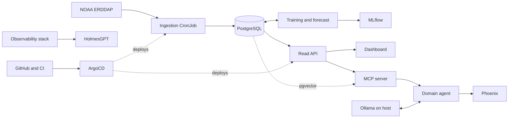

# Architecture

Everything here is Proposed unless marked Decided. Decided items come from `00-spec.md`.

## 1. Overview

Data enters through a daily ingestion job, is stored in PostgreSQL, and feeds the forecast, the read API and the agents. Everything runs in a Kubernetes cluster (local first, cloud later) and is deployed from Git.



The core is ingestion, database, API and dashboard. Everything else is added by branch and platform layer.

## 2. Technology stack

| Layer | Technology | Status | Why |
| --- | --- | --- | --- |
| Data source | NOAA Coral Reef Watch 5 km via ERDDAP | Decided | Public, daily, global |
| Language (data and ML) | Python | Proposed | Ecosystem for data and ML; owner already uses it |
| Database | PostgreSQL | Proposed | Relational, solid for time series at this volume |
| API | FastAPI | Proposed | Typed, generates OpenAPI |
| Dashboard | Next.js (TypeScript) | Proposed | Owner already uses it; keeps focus on data and infrastructure |
| Model | XGBoost with SHAP | Decided | Replicates the reference study and is explainable |
| ML tracking | MLflow | Proposed | Comparable history of runs |
| Containers | Docker | Proposed | Standard and already known |
| Local cluster | kind or k3d | Proposed | Free and repeatable |
| GitOps | ArgoCD | Proposed | Git as the source of truth for the cluster |
| Observability | Prometheus, Grafana, Loki, OpenTelemetry | Proposed | Open source, covers metrics, logs and traces |
| Operations agent | HolmesGPT | Decided | CNCF project that reads Prometheus, Loki and the Kubernetes API |
| Language model runtime | Ollama on the host with a small open-weight model | Proposed | Free, uses the laptop GPU, OpenAI-compatible API (ADR-006) |
| Agent tools | MCP server (Python SDK) | Proposed | Standard way to give agents tools; read-only by design (ADR-007) |
| Vector search | pgvector | Proposed | Extension of the existing PostgreSQL, no extra service (ADR-007) |
| LLM observability | Arize Phoenix | Proposed | Single container, built on OpenTelemetry (ADR-008) |
| IaC | Terraform on Azure | Proposed | Student Pack credits |
| CI | GitHub Actions | Proposed | Already used |

## 3. Components and responsibilities

| Component | Does | Does not do |
| --- | --- | --- |
| Ingestion job | Downloads NOAA data for defined sites, validates it, writes it idempotently, logs each run | Train models or serve users |
| PostgreSQL | Stores sites, observations, forecasts and run logs | Hold business logic beyond constraints and views |
| Training and forecast job | Builds features, trains, evaluates temporally, writes forecasts and SHAP values | Download NOAA data |
| MLflow | Records runs, parameters, metrics and artifacts | Serve predictions |
| Read API | Exposes sites, history and forecasts in a documented format | Write data (except the admin site catalog, see `04-api-guide.md`) |
| Dashboard | Shows status, series and explanations | Query the database directly |
| Domain agent | Answers questions using only the MCP tools, returns a structured answer with sources | Make predictions, write data or call anything outside its tools |
| MCP server | Exposes read-only tools: site status, forecast, document search | Write data or run arbitrary queries |
| Ollama (host) | Serves the language model and the embedding model | Run inside the cluster or store data |
| Phoenix | Stores and shows traces of model and tool calls | Store business data |
| Observability stack | Collects metrics, logs and traces and fires alerts | Store business data |
| HolmesGPT | Investigates alerts with read-only access | Change cluster state |
| ArgoCD | Syncs the cluster to what is in Git | Build images |

## 4. How the parts connect

| From | To | Protocol and data |
| --- | --- | --- |
| Ingestion job | NOAA ERDDAP | HTTPS requests for dataset subsets by site coordinates and date range |
| Ingestion job | PostgreSQL | SQL, upserts keyed by site and date |
| Training job | PostgreSQL | SQL reads of observations; writes forecasts |
| Training job | MLflow | HTTP, logs runs and artifacts |
| Read API | PostgreSQL | SQL with a read-only role |
| Dashboard | Read API | HTTPS, JSON |
| Domain agent | MCP server | MCP, read-only tools (`get_site_status`, `get_forecast`, `search_docs`) |
| MCP server | Read API | HTTPS, JSON, read-only |
| MCP server | PostgreSQL (pgvector) | SQL with a read-only role, similarity search over document chunks |
| Domain agent | Ollama | HTTP, OpenAI-compatible API on the host machine |
| Domain agent, HolmesGPT | Phoenix | OpenTelemetry traces of model and tool calls |
| Services | Observability stack | Prometheus scrape, OpenTelemetry export, logs to Loki |
| HolmesGPT | Prometheus, Loki, Kubernetes API | Read-only credentials |
| ArgoCD | GitHub | Git pull of manifests |

## 5. Main flows

**Daily ingestion**

1. The CronJob starts on schedule.
2. It reads the site catalog from the database.
3. It requests the latest available dates from ERDDAP for each site.
4. It validates ranges and dates.
5. It upserts rows keyed by site and date.
6. It writes an `ingestion_runs` record with rows, duration and errors.
7. It exposes metrics for freshness and failures.

**Forecast**

1. A scheduled job reads recent observations.
2. It builds features and loads the current model.
3. It writes forecasts with horizon, value and SHAP values.
4. The API serves the latest forecast per site.

**Ask the agent**

1. The user asks a question about a site in the dashboard.
2. The domain agent sends the question and its tool list to the model in Ollama.
3. The model calls read-only tools through the MCP server: site status, forecast, and document search over pgvector.
4. The agent returns a structured answer (text, sources, data used), validated against a schema.
5. The whole exchange is recorded as a trace in Phoenix.

**Deployment**

1. A commit lands on the main branch.
2. CI runs lint, tests and builds images.
3. A manifest change in Git is detected by ArgoCD.
4. ArgoCD syncs the cluster.

## 6. Repository structure (Proposed)

```
.
├── AGENTS.md                  # guide for AI agents
├── README.md
├── Makefile                   # one-command entry points (make up, make test)
├── docs/                      # this documentation suite
│   └── decisions/             # one short ADR per decision
├── services/
│   ├── ingestion/             # NOAA download and loading
│   ├── api/                   # read API
│   ├── ml/                    # features, training, forecast
│   ├── agents/                # domain agent, prompts and evaluations
│   ├── mcp/                   # MCP server with read-only tools
│   └── dashboard/             # Next.js app
├── db/
│   └── migrations/            # versioned schema changes
├── deploy/
│   ├── compose/               # Docker Compose for the core
│   └── k8s/                   # manifests (ArgoCD syncs this folder)
├── infra/
│   └── terraform/             # cloud, added in phase F8
├── observability/             # dashboards and alert rules as code
└── .github/workflows/         # CI
```

## 7. Data model (initial, Proposed)

| Entity | Key fields | Rules |
| --- | --- | --- |
| `sites` | id, name, latitude, longitude, active | Unique name; coordinates validated |
| `observations` | site_id, date, sst, anomaly, hotspot, dhw, alert_level | Unique on (site_id, date); ranges validated `[exact variables TO VERIFY in ERDDAP]` |
| `forecasts` | site_id, issued_at, horizon, value, shap_values, model_version | Unique on (site_id, issued_at, horizon) |
| `ingestion_runs` | id, started_at, finished_at, rows_written, status, error | Never updated after finishing |
| `doc_chunks` | id, source, title, chunk, embedding | Only public reference documents; embedding size fixed by the chosen model (Branch C) |

## 8. Environments and deployment

| Environment | Purpose | How it runs |
| --- | --- | --- |
| Local core | Fast development of ingestion, API and dashboard | Docker Compose with profiles |
| Local LLM | Agent development | Ollama on the host machine, outside the cluster (ADR-006) |
| Local cluster | Practice Kubernetes, GitOps and observability | kind or k3d |
| Cloud | Final demonstration | Azure created with Terraform, destroyed when idle |

## 9. Observability

| Signal | Tool | Example |
| --- | --- | --- |
| Metrics | Prometheus | Ingestion freshness, run failures, API latency |
| Logs | Loki | Ingestion and API logs with a run identifier |
| Traces | OpenTelemetry | API request through to the database |
| Dashboards and alerts | Grafana | Missing-data day, failed run, stale forecast |
| LLM traces | Phoenix | Prompt, answer, tokens, latency and tool calls per question |

## 10. Architecture decision log

Each decision lives in `docs/decisions/NNN-title.md` with: context, decision, alternatives discarded and why, and status. Initial entries to create in F0:

| ID | Decision | Status |
| --- | --- | --- |
| ADR-001 | Local cluster first, cloud later | Decided |
| ADR-002 | XGBoost with SHAP, starting from a baseline | Decided |
| ADR-003 | CronJob instead of Airflow for ingestion | Proposed |
| ADR-004 | FastAPI separate from the dashboard | Proposed |
| ADR-005 | PostgreSQL for observations | Proposed |
| ADR-006 | Local LLM with Ollama outside the cluster | Proposed |
| ADR-007 | Agent design: MCP tools, RAG with pgvector, structured outputs, no fine-tuning | Proposed |
| ADR-008 | Phoenix for LLM observability | Proposed |
| ADR-009 | Compose profiles and a local resource budget | Proposed |

## Open questions

- [ ] Exact variable names and units in the ERDDAP dataset.
- [ ] Do we need a time-series extension or is plain PostgreSQL enough?
- [ ] Helm or Kustomize for manifests?

## Related documents

[00-spec.md](00-spec.md) · [02-trd.md](02-trd.md) · [04-api-guide.md](04-api-guide.md) · [05-security-guide.md](05-security-guide.md) · [06-code-style-guide.md](06-code-style-guide.md)
